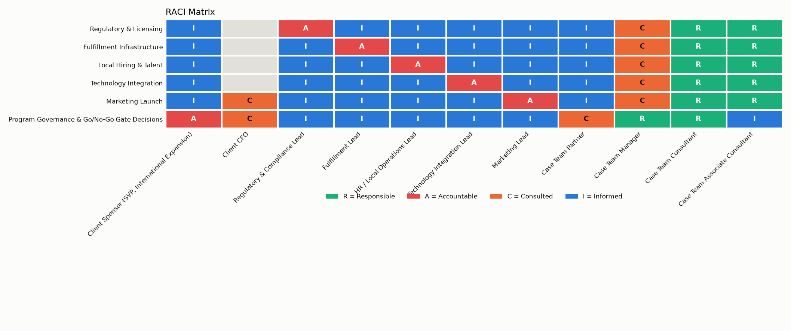
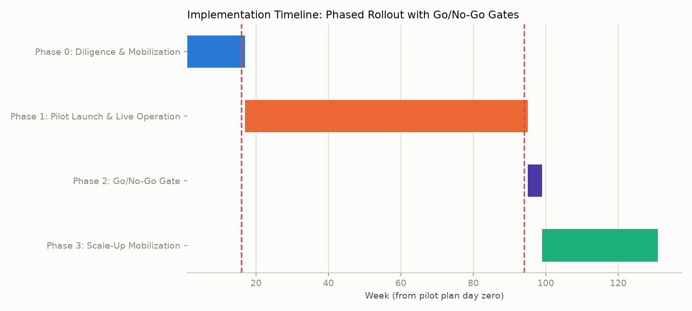
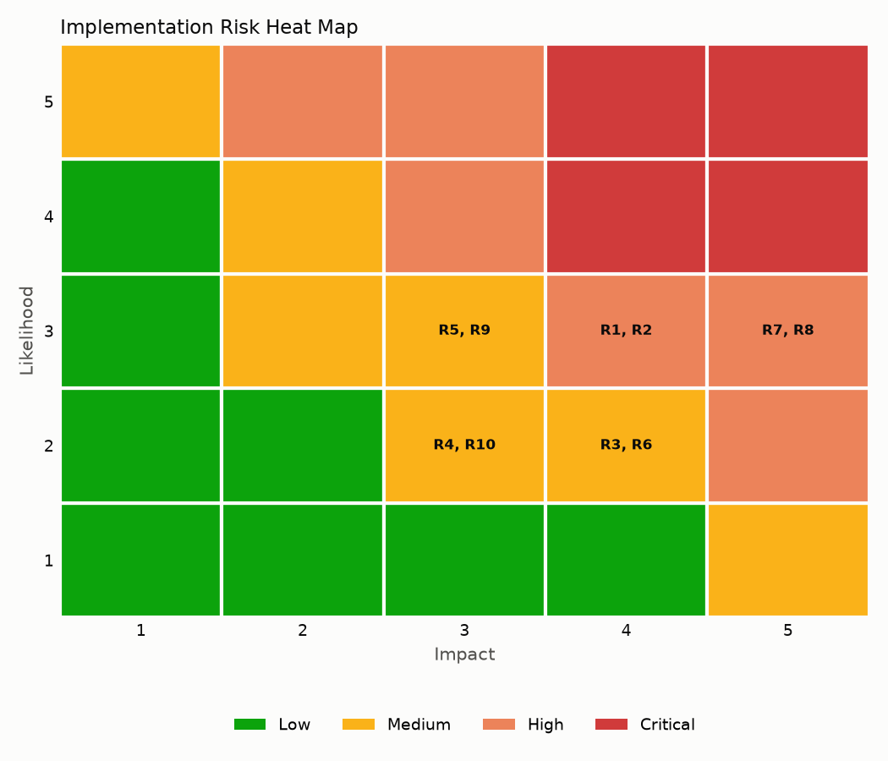

# Implementation Roadmap: FreshRoute GTA Pilot

**Carried forward from the original case:** Conditional go: proceed via a milestone-gated, partnership-based pilot in a subset of the GTA to prove out retention, delivery-cost, and CAC assumptions, with a formal reassessment of full-scale build-out economics at the 18-24 month mark.

This document is the implementation-planning layer that follows the [market-entry-case-toolkit](https://github.com/rxj0102/market-entry-case-toolkit)'s recommendation memo -- it does not re-run the market analysis. It takes the conditional-go decision as given and builds the workstream plan, RACI matrix, gated timeline, risk register, stakeholder communications, and staffing plan a case team delivers next.

## Unresolved Hypotheses This Pilot Must Close

- **[3.1]** Fulfillment model (partner-store picking + last-mile courier network) is replicable in the GTA without a new warehouse buildout -- *partially supported*. The pilot must prove: Partner-store picking accuracy and last-mile courier delivery cost per order hold within the assumptions used in the financial model, at real pilot-zone order volumes.
- **[3.2]** Regulatory, payments, and labor differences (GST/HST, cross-border data, employment law) are navigable within FreshRoute's existing compliance capability -- *partially supported*. The pilot must prove: FreshRoute can obtain the required GTA business licenses, clear a cross-border data review, and hire under Ontario employment law on the timeline the pilot plan assumes, without a dedicated new compliance build.
- **[4]** The entry is financially worth it on a risk-adjusted basis -- *not supported (for a full-scale launch as originally framed)*. The pilot must prove: Pilot-zone customer retention, delivery cost per order, and customer acquisition cost (CAC) land within the ranges the full-scale financial model requires to clear payback -- measured directly, not modeled.

## Workstream Plan

### [WS1] Regulatory & Licensing (wave 0)
- **Owner:** Regulatory & Compliance Lead (client)
- **Depends on:** None
- **Resolves case hypothesis:** 3.2
- **Description:** Obtain the business licenses, tax registrations, and compliance clearances required to operate a grocery-delivery business in Ontario, and confirm cross-border data handling meets FreshRoute's existing compliance posture.
- **Key deliverables:**
  - Ontario business license and GST/HST registration secured
  - Cross-border data-handling review signed off by client legal
  - Employment-standards compliance review for Ontario hires

### [WS2] Fulfillment Infrastructure (wave 1)
- **Owner:** Fulfillment Lead (client)
- **Depends on:** WS1
- **Resolves case hypothesis:** 3.1
- **Description:** Stand up partner-store picking agreements and a third-party last-mile courier network for the single pilot zone -- deliberately capital-light, no new owned warehouse.
- **Key deliverables:**
  - Signed partner-store picking agreements covering the pilot zone
  - Contracted last-mile courier network with agreed SLAs
  - Pilot-zone fulfillment cost-per-order baseline established

### [WS3] Local Hiring & Talent (wave 1)
- **Owner:** HR / Local Operations Lead (client)
- **Depends on:** WS1
- **Resolves case hypothesis:** 3.2
- **Description:** Recruit and onboard the pilot-zone operations team: local market lead, courier-network coordinator, and customer support staff, under Ontario employment law.
- **Key deliverables:**
  - Pilot-zone operations team hired and onboarded
  - Local market lead in place ahead of pilot launch

### [WS4] Technology Integration (wave 1)
- **Owner:** Technology Integration Lead (client)
- **Depends on:** WS1
- **Description:** Adapt FreshRoute's existing US ordering, routing, and payments platform for the Canadian market: currency, tax calculation, payments rails, and partner-store inventory integration.
- **Key deliverables:**
  - Platform localized for CAD pricing, GST/HST tax calculation, and Canadian payments rails
  - Partner-store inventory feed integrated for the pilot zone

### [WS5] Marketing Launch (wave 2)
- **Owner:** Marketing Lead (client)
- **Depends on:** WS2, WS3, WS4
- **Resolves case hypothesis:** 4
- **Description:** Design and execute a pilot-zone customer-acquisition campaign sized to test CAC assumptions cleanly, not to maximize volume.
- **Key deliverables:**
  - Pilot-zone launch campaign live
  - CAC-by-channel tracking in place from day one of the pilot

## RACI Matrix

| Workstream | Client Sponsor (SVP, International Expansion) | Client CFO | Regulatory & Compliance Lead | Fulfillment Lead | HR / Local Operations Lead | Technology Integration Lead | Marketing Lead | Case Team Partner | Case Team Manager | Case Team Consultant | Case Team Associate Consultant |
|---|---|---|---|---|---|---|---|---|---|---|---|
| Regulatory & Licensing | I | - | A | I | I | I | I | I | C | R | R |
| Fulfillment Infrastructure | I | - | I | A | I | I | I | I | C | R | R |
| Local Hiring & Talent | I | - | I | I | A | I | I | I | C | R | R |
| Technology Integration | I | - | I | I | I | A | I | I | C | R | R |
| Marketing Launch | I | C | I | I | I | I | A | I | C | R | R |
| Program Governance & Go/No-Go Gate Decisions | A | C | I | I | I | I | I | C | R | R | I |

**Legend:** R = Responsible (does the work), A = Accountable (owns the outcome, exactly one per row), C = Consulted (two-way input before a decision), I = Informed (one-way notification after a decision), - = not involved.

## Milestone Timeline

| Phase | Weeks | Duration | Active Workstreams |
|---|---|---|---|
| Phase 0: Diligence & Mobilization | 1-16 | 16w | WS1, WS2, WS3, WS4 |
| Phase 1: Pilot Launch & Live Operation | 17-94 | 78w | WS2, WS3, WS4, WS5 |
| Phase 2: Go/No-Go Gate | 95-98 | 4w | - |
| Phase 3: Scale-Up Mobilization | 99-130 | 32w | WS1, WS2, WS3, WS4, WS5 |

### Phase 0: Diligence & Mobilization (weeks 1-16)
**Objectives:**
- Secure regulatory clearance to operate in Ontario
- Sign partner-store and courier agreements for the pilot zone
- Hire and onboard the pilot-zone operations team
- Localize the ordering/payments platform for the Canadian market

**Pilot Readiness Gate** (week 16, decision owner: MANAGER)

| Criterion | Tied to hypothesis |
|---|---|
| Ontario business license and GST/HST registration obtained | - |
| Partner-store picking agreements signed for the pilot zone | - |
| Last-mile courier network contracted with agreed SLAs | - |
| Pilot-zone operations team hired and onboarded | - |
| Platform localized for CAD pricing, GST/HST tax calculation, and Canadian payments rails | - |

**Possible outcomes:** Proceed to pilot launch; Delay launch (specific readiness criteria unmet)

### Phase 1: Pilot Launch & Live Operation (weeks 17-94)
**Objectives:**
- Launch live ordering and fulfillment in the pilot zone
- Run the sized customer-acquisition campaign and track CAC by channel from day one
- Instrument retention, delivery cost-per-order, and contribution margin reporting for the go/no-go gate

### Phase 2: Go/No-Go Gate (weeks 95-98)
**Objectives:**
- Assemble pilot performance data against every gate criterion
- Convene the client sponsor, CFO, and case team to render the scale-up decision

**Go/No-Go Gate** (week 94, decision owner: SPONSOR)

| Criterion | Tied to hypothesis |
|---|---|
| Partner-store fulfillment cost per order lands within the range the financial model assumes | 3.1 |
| Last-mile courier network sustains an on-time delivery rate consistent with the retention assumptions in the financial model | 3.1 |
| No unresolved regulatory, tax, or employment-law finding from operating the pilot zone | 3.2 |
| Pilot-zone customer retention at the cohort ages the financial model relies on meets or exceeds the modeled rate | 4 |
| Blended customer acquisition cost (CAC) is at or below the level the base-case financial model requires for payback | 4 |
| Pilot-zone contribution margin is trending toward the payback path the base-case financial model requires | 4 |

**Possible outcomes:** Scale up (commit to full build-out economics reassessment); Extend pilot 6 months (inconclusive on one or more criteria); Wind down (criteria not met; exit the pilot zone)

### Phase 3: Scale-Up Mobilization (weeks 99-130)
**Objectives:**
- Re-run full-scale financial feasibility using pilot-proven assumptions rather than modeled ones
- Expand partner-store and courier agreements beyond the pilot zone
- Begin hiring and technology scale-up for the wider GTA rollout

## Implementation Risk Register

| ID | Category | Risk | Likelihood | Impact | Score | Severity | Mitigation Owner | Early-Warning Indicator |
|---|---|---|---|---|---|---|---|---|
| R7 | Marketing / Commercial | Customer acquisition cost (CAC) exceeds the financial model's threshold because the pilot-zone campaign attracts low-intent or out-of-zone customers | 3 | 5 | 15 | High | MKT_LEAD | Blended CAC exceeds the financial model's threshold for 2+ consecutive reporting weeks |
| R8 | Marketing / Commercial | Pilot-zone customer retention falls short of the level the financial model requires, driven by delivery reliability or assortment gaps rather than price | 3 | 5 | 15 | High | MKT_LEAD | Week-8 cohort retention trending below the financial model's required curve |
| R1 | Fulfillment | Partner-store picking accuracy or throughput degrades once real pilot-zone order volume hits, beyond what was tested in the initial agreement | 3 | 4 | 12 | High | FULFILL_LEAD | Picking-error rate or order-fulfillment cycle time trending above the partner-store agreement's committed threshold for 2+ consecutive weeks |
| R2 | Fulfillment | Third-party courier network cannot sustain agreed delivery SLAs during demand spikes (weekends, promotions) | 3 | 4 | 12 | High | FULFILL_LEAD | On-time delivery rate below 92% in any rolling 2-week window |
| R5 | Talent | Local hiring shortfall or high early turnover in pilot-zone operations roles (market lead, courier coordinator, support staff) | 3 | 3 | 9 | Medium | HR_LEAD | Any pilot-zone operations role unfilled within 2 weeks of its Phase 0 target date, or first-90-day turnover above 15% |
| R9 | Change Management | Cross-functional friction between the client's existing US operations team and the new GTA pilot team slows decisions (e.g. platform-change approvals, shared vendor contracts) | 3 | 3 | 9 | Medium | MANAGER | Cross-team decision requests taking longer than 5 business days to resolve, self-reported by either team |
| R3 | Regulatory | Ontario business license or GST/HST registration is delayed, pushing back the pilot launch date | 2 | 4 | 8 | Medium | REG_LEAD | No confirmation of filing acceptance by week 8 of Phase 0 |
| R6 | Technology | Platform localization (CAD pricing, tax calculation, payments rails, partner-store inventory feed) slips past the Phase 0 readiness gate | 2 | 4 | 8 | Medium | TECH_LEAD | Core localization not passing integration testing by week 10 of Phase 0 |
| R4 | Regulatory | Cross-border customer-data handling review surfaces a finding that requires a platform rework mid-pilot | 2 | 3 | 6 | Medium | REG_LEAD | Data review not signed off by the end of Phase 0 |
| R10 | Case Team Continuity | Case-team staffing churn mid-pilot (a Consultant or Associate Consultant rotating off) causes institutional knowledge loss on why specific gate criteria or mitigation plans were set the way they were | 2 | 3 | 6 | Medium | MANAGER | Any case-team rotation announced with less than 2 weeks of overlap with their successor |

**Mitigations:**
- **R7:** Launch with narrow, geo-fenced targeting only, and track CAC by channel from day one so an underperforming channel is paused, not scaled
- **R8:** Instrument cohort-level retention reporting from week 1 (not just at the gate), so a retention shortfall surfaces early enough to diagnose and fix before the go/no-go gate
- **R1:** Phase in order volume with a ramp schedule agreed with partner stores; weekly picking-accuracy audits for the first 8 weeks of live operation
- **R2:** Contract a secondary backup courier for the pilot zone; cap promotional-driven demand spikes until SLA performance is proven at baseline volume
- **R5:** Start recruiting in parallel with Phase 0 regulatory work rather than after it clears; build a hiring-pipeline buffer of two extra qualified candidates per role
- **R9:** Stand up a joint US/GTA decision forum with clear escalation paths at Phase 0 kickoff, before friction has a chance to calcify into informal workarounds
- **R3:** Engage local Ontario counsel at Phase 0 kickoff (not after an internal filing attempt stalls); build a 4-week buffer into the Phase 0 timeline for regulatory turnaround
- **R6:** Sequence the partner-store inventory integration after core CAD/tax/payments localization, so a slip in the harder integration doesn't block the simpler, higher-confidence pieces
- **R4:** Complete the cross-border data review before, not alongside, the technology-integration workstream, so any required rework is designed in rather than retrofitted
- **R10:** Maintain the mentorship/onboarding plan in `staffing_plan.py` as a living handoff document, not a one-time induction, so any incoming team member can pick up context without re-deriving it from scratch

## Stakeholder Communication Plan

| Audience | Frequency | Channel | Content Focus | Owner |
|---|---|---|---|---|
| Client Sponsor & CFO (Steering Committee) | Monthly | Steering committee readout (deck + live discussion) | Progress against gate criteria, financial tracking, top risks, decisions needed from leadership | PARTNER |
| Client Functional Leads (Regulatory, Fulfillment, HR, Technology, Marketing) | Weekly | Cross-functional operations sync (video call) | Workstream status, blockers, and dependency handoffs between workstreams | MANAGER |
| Pilot-Zone Operations Team (including new hires) | Daily | Stand-up (in-person or video) | Day-to-day execution status, immediate blockers, onboarding support for new team members | HR_LEAD |
| Broader Client Organization (existing US operations and other functions) | Monthly | Company newsletter / all-hands update | Pilot milestones reached, what to expect next, how the pilot affects existing teams' processes or shared systems | MANAGER |
| Case Team (internal) | Weekly | Internal working session | RACI and risk-register updates, gate-readiness tracking, and a standing mentorship check-in for junior team members | PARTNER |
| Client Sponsor & CFO | At each gate (ad hoc) | Gate decision memo + review meeting | Gate criteria results against threshold, recommended decision, and the options actually on the table | PARTNER |

## Change Management Narrative

**Pilot:** Conditional go: proceed via a milestone-gated, partnership-based pilot in a subset of the GTA to prove out retention, delivery-cost, and CAC assumptions, with a formal reassessment of full-scale build-out economics at the 18-24 month mark.

### Where the friction will come from

- New GTA pilot-zone hires (local market lead, courier-network coordinator, support staff) joining an organization whose processes, tooling, and culture were built around 15 established U.S. metro markets, not a first international pilot.
- Decision rights between the existing U.S. operations team and the new GTA pilot team are not yet precedented -- shared vendor contracts, platform-change approvals, and data-handling policy all touch both.
- The pilot's capital-light, milestone-gated structure (a deliberate choice given the financial case did not clear payback at full scale) means the GTA team is operating with more scrutiny and a shorter runway to prove itself than a typical new-market launch team would have.
- Risk register item R9: Cross-functional friction between the client's existing US operations team and the new GTA pilot team slows decisions (e.g. platform-change approvals, shared vendor contracts)

### The new-hire challenge, specifically

Workstream WS3 (Local Hiring & Talent) hires a pilot-zone market lead, courier-network coordinator, and customer support staff -- all new to FreshRoute, several new to on-demand grocery delivery, joining mid-implementation rather than at company founding. Onboarding them mid-implementation -- after the regulatory and fulfillment groundwork is already underway rather than at a clean company-founding starting point -- means their ramp-up has to happen alongside live execution, not before it. That is exactly what `staffing_plan.py`'s mentorship plan is designed to shorten.

### How this is being managed, not just acknowledged

Frame the organizational friction as real and specifically named, but manageable through structured governance (a joint US/GTA decision forum, explicit escalation paths, a living mentorship/onboarding plan) -- not as a reason to slow down or de-scope the pilot. The pilot's whole premise is proving execution capability, not just market opportunity.

## Team Staffing & Mentorship Plan

### Staffing Allocation

| Seniority | % of Time on Engagement | WS1 | WS2 | WS3 | WS4 | WS5 | GOV | MENTORSHIP |
|---|---|---|---|---|---|---|---|---|
| Partner | 10% | 5% | 5% | 0% | 0% | 10% | 70% | 10% |
| Manager | 75% | 15% | 20% | 15% | 15% | 15% | 10% | 10% |
| Consultant | 100% | 15% | 25% | 15% | 20% | 15% | 5% | 5% |
| Associate Consultant | 100% | 10% | 20% | 20% | 20% | 20% | 5% | 5% |

*Percentages in WS1-WS5/GOV/MENTORSHIP columns are each person's own time split, not a share of the whole team's effort.*

### Onboarding & Mentorship Plan (Associate Consultant joining mid-implementation)

**Week 0: Context handoff session** (mentor: Manager)
- Full walkthrough of the case history: the original hypothesis tree and conditional-go recommendation (case_context.py), current workstream status (workstream_planner.py), the RACI matrix, and the live risk register -- delivered by the Manager and Consultant together, using this package's own outputs as the handoff document rather than an ad hoc verbal briefing.

**Week 1: Shadow a workstream cycle** (mentor: Consultant)
- Shadow the Consultant through one full weekly tracking cycle on a single assigned workstream: how status is gathered, how blockers get escalated, how the RACI is actually used in a live handoff dispute.

**Week 2: Own a risk-register update, reviewed before circulation** (mentor: Consultant)
- Independently update the risk register's likelihood/impact scoring and early-warning indicators for two assigned workstreams; the Consultant reviews before it goes to the weekly cross-functional sync.

**Week 4: Co-lead the cross-functional ops sync** (mentor: Consultant)
- Lead the weekly cross-functional operations sync for one cycle, with the Consultant present as a silent backup rather than a lead -- the first time the new team member is client-facing rather than only case-team-facing.

**Week 8: Independent workstream ownership** (mentor: Consultant)
- Independently own tracking and reporting for assigned workstreams. Mentorship check-in cadence moves from weekly to biweekly -- a deliberate step-down, not a silent stop, so support doesn't just evaporate once the new team member looks competent.

**Week 12: Standing mentorship check-in** (mentor: Manager)
- Biweekly 1:1 with the Consultant and a monthly check-in with the Manager continue for the remainder of the engagement -- mentorship is treated as ongoing time-boxed work (see `build_staffing_plan()`'s MENTORSHIP allocation), not a milestone that's 'done' once reached.

---
*Change-management narrative generated in **template** mode -- see `stakeholder_comms.py`. All names, figures, and dates in this document are illustrative, hand-set proxies for a portfolio case study, not real client data. See the README for the full disclaimer.*
